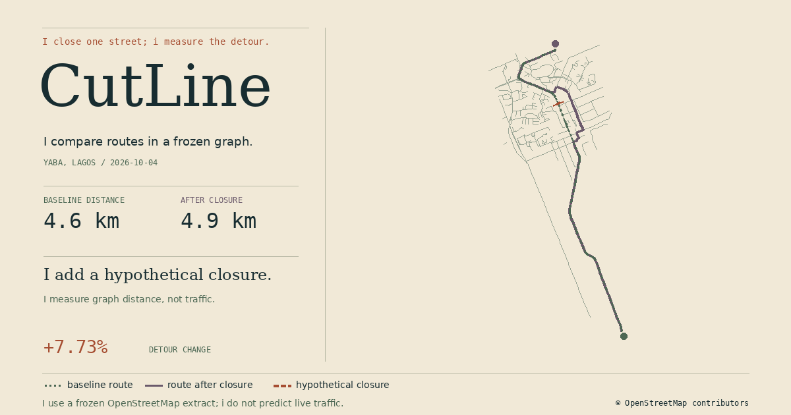

# CutLine

I close one street in a frozen street graph and measure what changes; i show detours, route loss, and reachable nodes without pretending to predict traffic.

I built CutLine as a local portfolio project around a small OpenStreetMap extract from Yaba, Lagos. i bundle the data, serve the atlas on loopback, and make no account or live map request part of the demo.



## I run the bundled demo

I use a Linux x86_64 or macOS x86_64/arm64 machine with `curl`, `tar`, and `make`; i keep Node, opam, Elm, npm caches, and OCaml dependencies outside the repository.

```sh
make setup
make demo
```

I open the `http://127.0.0.1:.../` address printed by the command; i stop the local server with Ctrl-C. i run `make setup` once to install and cache pinned tools and packages; after that, `make demo` reads the bundled graph and local assets without outbound requests or account setup. i keep the warmed demo startup under five minutes on ordinary hardware.

I run both language suites, the production frontend compiler, a bootstrap syntax check, and a loopback HTTP smoke test with:

```sh
make test
```

I use Node 22.23.3, OCaml 5.5.1, opam 2.6.0, Dune 3.24.2, Elm 0.19.2, Alcotest 1.9.1, and elm-test 0.19.2-0. i pin npm and Elm dependencies in their lockfiles; i cache Node, Elm, npm, and opam executables under `~/.cache/cutline` and the OCaml switch under `~/.cache/opam`.

## I explore the graph

I choose an origin node, a destination node, and a street segment; i close or reopen that segment and recalculate the route locally. i can also select a segment directly from the drawn network. i compare the original route, changed route, detour change, and the number of graph nodes reachable from the origin.

I keep distances as integer millimeters and percentage changes as integer basis points in the routing core; i format the same integer results for the display. i draw the map as a fitted local graph, not as a navigable basemap.

## I separate real data from the demo

I use real, frozen OpenStreetMap street geometry, source way ids, node ids, and direction tags from a 2026-10-04 Yaba extract. i record the source URL, bounding box, counts, attribution, and ODbL-1.0 terms in [`data/demo/README.md`](data/demo/README.md) and [`data/demo/metadata.json`](data/demo/metadata.json).

I use a hypothetical closure as the demo scenario; i do not represent a live road closure or field observation. i claim only graph shortest paths and reachability over the recorded extract, direction tags, projection, and selected closure set. i do not model live traffic, travel time, access restrictions, turn restrictions, safety, accessibility, emergency response, or real-world resilience.

## I import a local extract

I accept a bounded GeoJSON `FeatureCollection` containing street `LineString` features; i preserve source way ids, optional OSM node ids, and supported `oneway` tags. i reject oversized or invalid inputs and write a versioned normalized graph.

```sh
make import INPUT=streets.geojson OUTPUT=network.cutline.json
make serve GRAPH=network.cutline.json
```

I keep raw OSM PBF parsing, turn restrictions, access rules, and traffic simulation outside v0.1. i document the supported import subset and graph schema in [`docs/architecture.md`](docs/architecture.md).

## I keep the language boundary small

I use OCaml for import, graph validation, deterministic routing, and the local HTTP service; i use Elm for the typed browser state and map rendering. i use JavaScript only to start the compiled Elm module, with no UI framework or route logic. i wrote the language case before implementation in [`docs/architecture.md`](docs/architecture.md), and i set the visual contract before building the screen in [`docs/design.md`](docs/design.md).

## I keep the project honest

I treat every closure as a graph experiment rather than an observation; i treat each route length as a measurement over the stored graph rather than a real-world travel prediction. i keep the demo offline at runtime and make the source and data boundaries visible beside the map.

## I read the project notes

- I keep the architecture and numeric contract in [`docs/architecture.md`](docs/architecture.md).
- I keep the visual system and interaction contract in [`docs/design.md`](docs/design.md).
- I keep the extract provenance and data license in [`data/demo/README.md`](data/demo/README.md).
- I keep setup and contribution steps in [`CONTRIBUTING.md`](CONTRIBUTING.md).
- I keep the local threat model and reporting path in [`SECURITY.md`](SECURITY.md).
- I keep the first release notes in [`CHANGELOG.md`](CHANGELOG.md).
- I keep repository profile copy in [`docs/github.md`](docs/github.md).
- I seed small follow-ups in [`docs/good-first-issues.md`](docs/good-first-issues.md).
- I keep the public launch copy in [`launch/README.md`](launch/README.md).

## I credit the source data

I credit © OpenStreetMap contributors; i publish the derived demo extract under ODbL-1.0 and the application source under MIT. i keep the data license separate from the source-code license.
